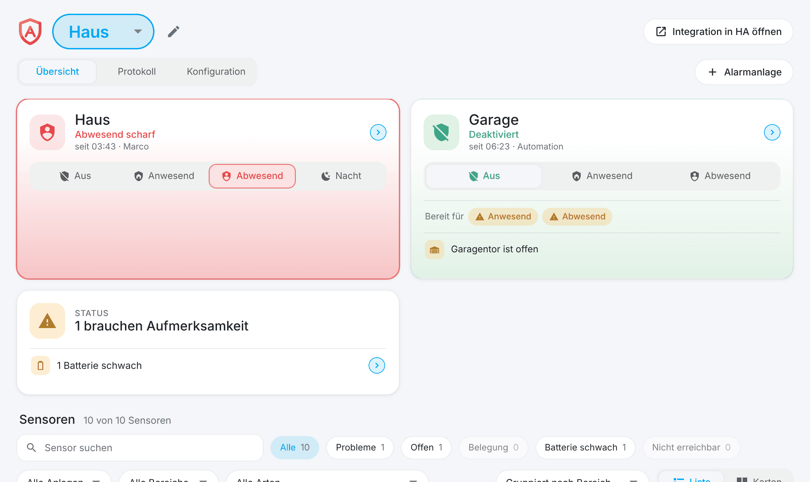
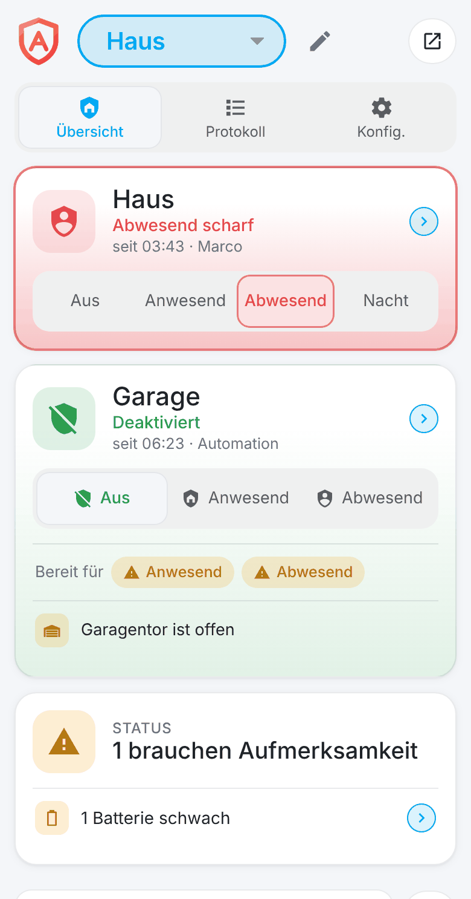
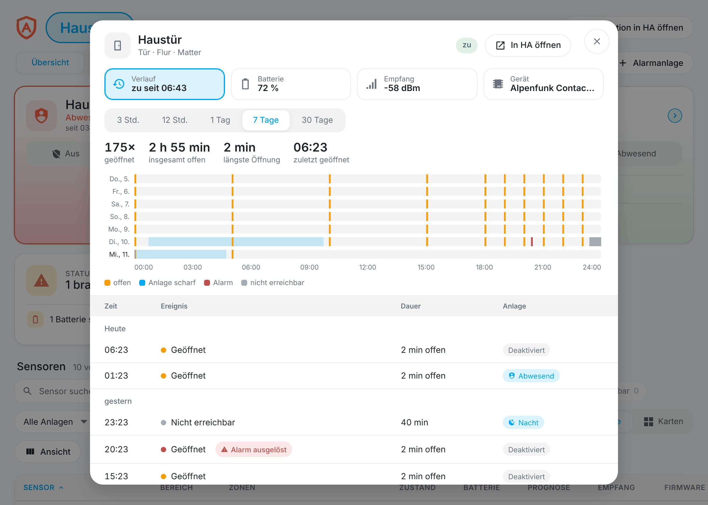
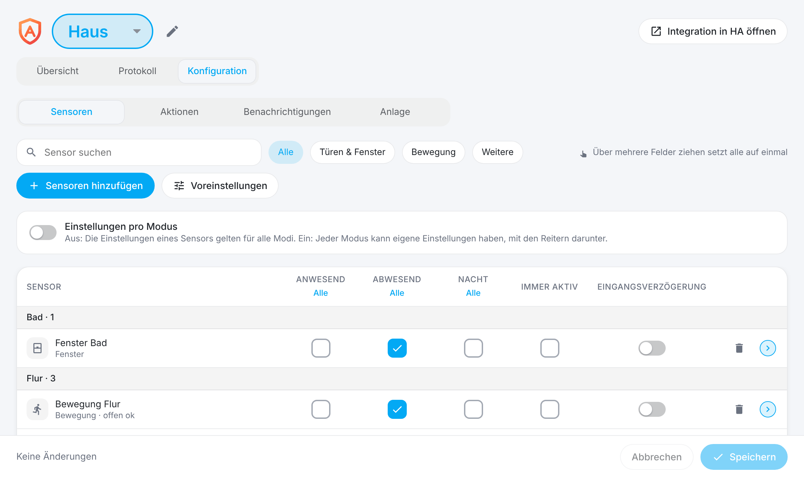
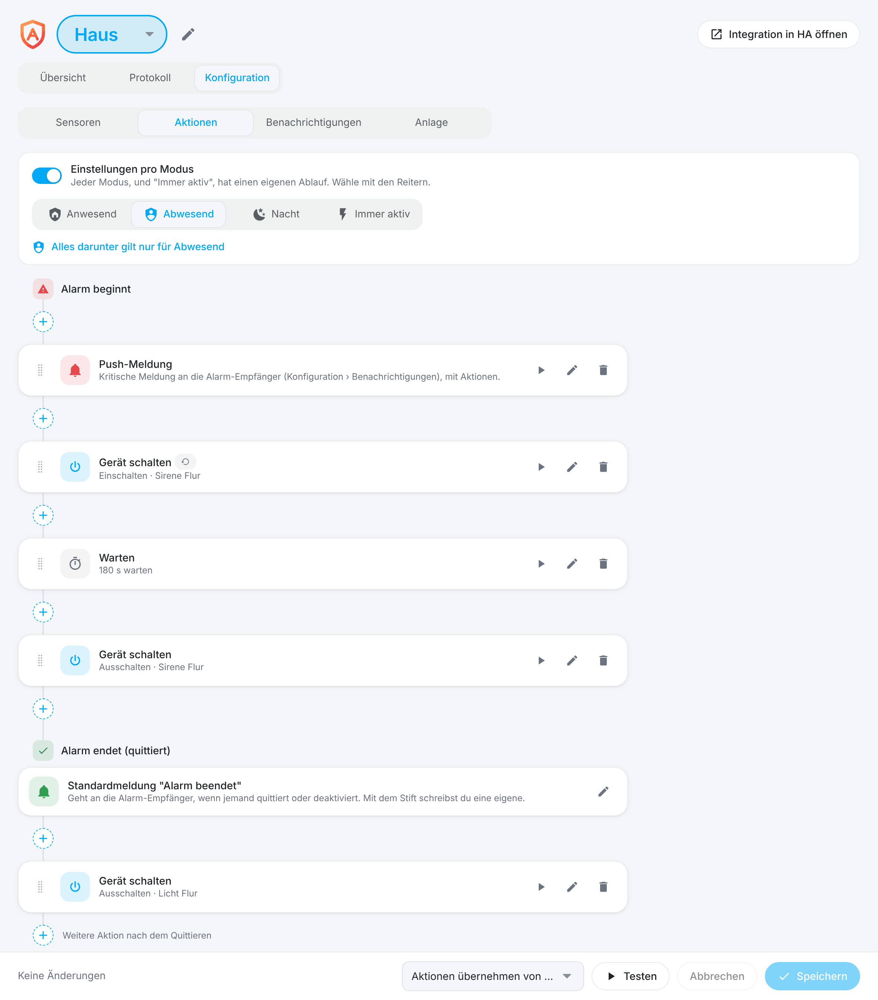
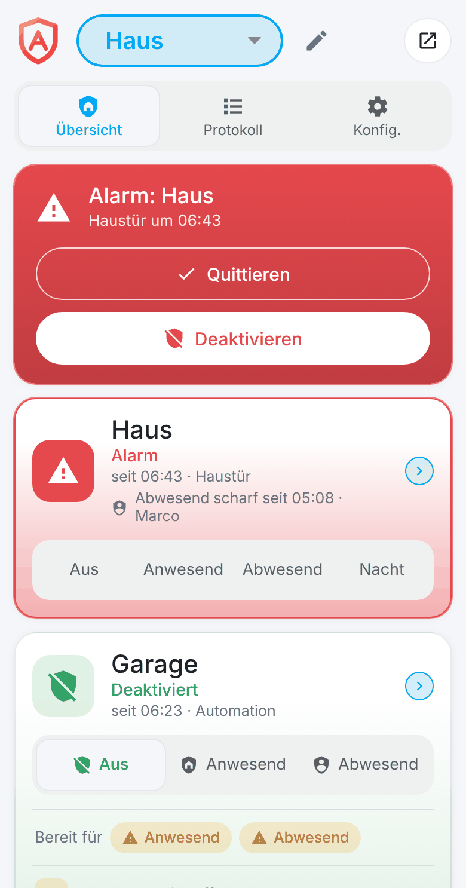
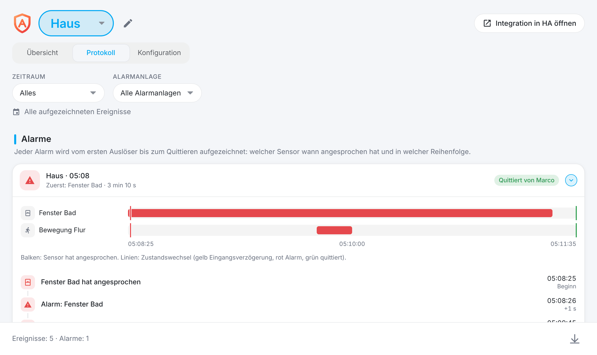
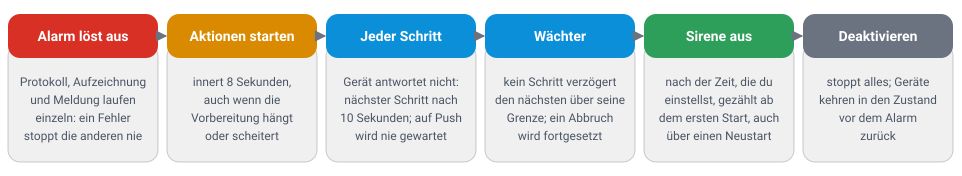
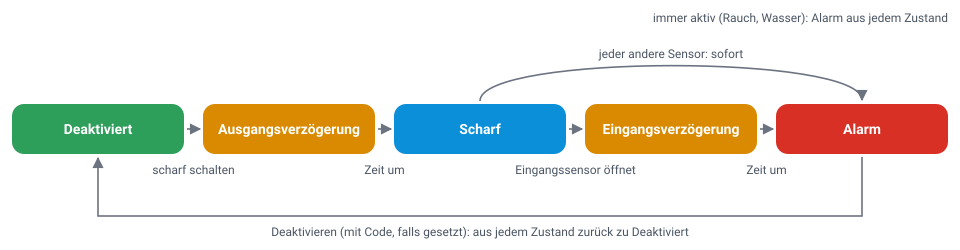

<p align="center"></p>

# Alarmageddon

[English](https://github.com/Diegofuego871/ha-Alarmageddon/blob/main/README.md)

Eine vollständige Alarmanlage für Home Assistant: ohne eine einzige Automation, mit Push-Meldungen, die von selbst kommen, und ganz in einer grafischen Oberfläche eingerichtet.

> **Status:** stabil (1.0.0). Alles hier Beschriebene ist durch automatische Tests abgedeckt, und der ganze Code wurde in einem externen Code-Review geprüft. Mit allen Arten von Geräten wurde es noch nicht ausprobiert: Bitte melde Probleme als Issue.

<p align="center"></p>

## Warum Alarmageddon

- **Keine Automationen nötig.** Alles, was eine Alarmanlage ausmacht, ist eingebaut: Zonen je Modus, Ein- und Ausgangsverzögerung, Sirene und Alarmton, Zeitplan, Codes pro Person, Bestätigung durch zwei Sensoren. Du verdrahtest nichts selbst, weder Automationen noch Helfer noch Skripte.
- **Push-Meldungen kommen von selbst.** Alarm, Eingangsverzögerung, scharf und deaktiviert, Scharfschalten nicht möglich, Sensor nicht erreichbar, Batterie schwach: Du wählst nur, wer sie bekommt. Die Alarmmeldung bringt ihre Knöpfe mit ("Quittieren", "Deaktivieren", "Sirene stumm"), auf Wunsch kritisch, damit sie auch im Stumm-Modus ertönt.
- **Alles grafisch einstellbar.** Ein Seitenpanel für Sensoren, Zonen, Verzögerungen, Alarmaktionen, Benachrichtigungen, Zeitplan, Codes und Sicherung, am Computer wie auf dem Handy. Kein YAML. Was bei einem Alarm passiert, baust du als Ablauf aus Schritten zusammen und probierst jeden Schritt mit einem Knopf an den echten Geräten aus.
- **Deine Sensoren werden überwacht, nicht nur benutzt.** Batteriestand mit Prognose, nicht erreichbare Sensoren, Signal, Firmware und die letzte Änderung jedes Sensors in einer Liste, dazu für jeden Sensor der Verlauf der letzten 30 Tage. Fällt ein Sensor im scharfen Zustand aus, wird das gemeldet oder zählt auf Wunsch als Alarm.
- **Du siehst, was passiert ist.** Jeder Alarm wird mit Zeitachse aufgezeichnet: welcher Sensor wann angesprochen hat, welche Schritte liefen, welche Meldungen hinausgingen, wer quittiert hat.
- **Gebaut, um im Zweifel zu alarmieren.** Verzögerungen und Alarme überstehen einen Neustart, nichts kann die Sirene aufhalten, und ein Wächter beaufsichtigt die Alarmaktionen. Siehe [Sicherheitsmechanismen](#sicherheitsmechanismen).
- **Passt in Home Assistant.** Jede Anlage ist eine gewöhnliche `alarm_control_panel`-Entität für Dashboards, eigene Automationen und Apple Home. Jeder Sensor, den Home Assistant kennt, funktioniert: Zigbee, Z-Wave, Thread/Matter, WLAN oder Bluetooth.
- **Bleibt zu Hause.** Keine Cloud, kein Konto: alles läuft in deinem Home Assistant.

## Schnellstart

1. **Installieren:** HACS → drei Punkte → "Benutzerdefinierte Repositories" → `https://github.com/Diegofuego871/ha-Alarmageddon`, Typ "Integration". "Alarmageddon" installieren und Home Assistant neu starten.
2. **Anlage hinzufügen:** Einstellungen → Geräte & Dienste → "Integration hinzufügen" → "Alarmageddon". Name vergeben und, wenn du willst, einen Code.
3. **Sensoren wählen:** "Alarmageddon" in der Seitenleiste öffnen (nur Administratoren), dann Konfiguration › Sensoren › "Sensoren hinzufügen", und die Zonen "Anwesend", "Abwesend" und "Nacht" ankreuzen.
4. **Festlegen, was bei einem Alarm passiert:** Konfiguration › Aktionen, zum Beispiel "Push-Meldung, Sirene ein, 3 Minuten warten, Sirene aus".
5. **Wählen, wer benachrichtigt wird:** Konfiguration › Benachrichtigungen. Mit "Testmeldung senden" und dem Abspielknopf eines Schritts probierst du alles ohne Alarm aus.

## Ein Rundgang

### Übersicht

Alle Anlagen auf einen Blick: scharf schalten und deaktivieren, "Bereit für" je Modus mit den Sensoren, die das Scharfschalten noch verhindern, eine Statuskachel für Warnungen und alle Sensoren als Liste oder als Karten, mit Suche, Filtern, Sortierung, wählbaren Spalten und Gruppierung nach Bereich, Sensorart oder Anlage. Ein Tipp auf einen Sensor öffnet seine Ansicht: was er in den letzten Stunden oder bis zu 30 Tagen getan hat (mit einer Grafik je Sensorart und der Liste der Ereignisse), wie es um Batterie und Empfang steht, und ein Knopf, der ihn in Home Assistant öffnet. In der Ansicht wählst du auch, wie die Sensoren heissen: "Gerät - Sensor" oder nur der Name des Sensors, überall gleich bis in die Push-Meldung. Dasselbe auf dem Handy:

<p align="center"></p>

### Sensoransicht

Ein Tipp auf einen Sensor zeigt, was er getan hat: je Sensorart eine eigene Grafik über 3 Stunden bis 30 Tage (Türen und Fenster als Zeitleiste, Bewegung als Raster aus Tag und Stunde), darunter die Ereignisse mit Dauer und dem Zustand der Anlage in diesem Moment. Die Kacheln "Batterie" und "Empfang" zeigen deren Verlauf, die Batterie mit Warnschwelle, Batteriewechsel und Prognose.

<p align="center"></p>

### Sensoren und Zonen

Eine Tabelle für Sensoren und Zonen: ankreuzen, wohin ein Sensor gehört, oder über mehrere Kästchen ziehen. Jede Sensorart hat sinnvolle Voreinstellungen (ein Rauchmelder ist immer aktiv, ein Bewegungsmelder darf beim Scharfschalten noch Bewegung melden), jeder Sensor kann eigene Werte haben, und der Schalter "Einstellungen pro Modus" bringt einen Reiter je Modus für alle, die mehr wollen.

<p align="center"></p>

### Alarmaktionen

Was bei einem Alarm passiert, ist ein Ablauf aus Schritten, auf Wunsch je Modus. Geräte mit dem Pfeilsymbol kehren beim Deaktivieren in ihren vorherigen Zustand zurück, und jeder Schritt lässt sich mit seinem Abspielknopf an den echten Geräten testen.

<p align="center"></p>

| Schritt | Macht |
| --- | --- |
| Push-Meldung | Kritische Alarmmeldung an die Alarm-Empfänger, mit eigenem Titel und Text, wählbaren Knöpfen und auf Wunsch eigenen Empfängern (jeder Titel beginnt mit einem Emoji) |
| Gerät schalten | Lichter, Steckdosen, Sirenen, Storen, Schlösser und mehr: ein, aus, öffnen, schliessen, mit Helligkeit oder Position |
| Alarmton abspielen | Einer von fünf Tönen auf Medienplayern (Sonos und andere), mit Lautstärke, für eine Dauer oder bis zum Deaktivieren |
| Warten | Hält die folgenden Schritte an, zum Beispiel zwischen "Sirene ein" und "Sirene aus" |
| Alarm beenden (quittieren) | Beendet den Alarm nach den Schritten davor (zum Beispiel nach 3 Minuten), stellt die Geräte zurück und lässt die Anlage scharf; die Schritte danach laufen nicht mehr |
| Szene, Skript oder eigene Aktion | Alles andere, was Home Assistant kann |

### Benachrichtigungen

Empfänger wählst du getrennt für Alarme und für Wartungsmeldungen, und jede Meldung kann sie mit eigenen Empfängern überschreiben (auch je Modus). Jede Art von Meldung (Eingangsverzögerung, scharf, deaktiviert, Scharfschalten nicht möglich, Stiller Alarm, Sensor nicht erreichbar, Batterie schwach) lässt sich ein- und ausschalten, kritisch senden (ertönt auch im Stumm-Modus) und hat ihre eigene Lautstärke, auf Wunsch je Modus.

### Bei einem Alarm

Ein Alarm ist nicht zu übersehen: ein rotes Band mit dem Sensor, der ausgelöst hat, und den Knöpfen "Quittieren" (der Alarm endet, die Anlage bleibt scharf) und "Deaktivieren". Die Kachel der Anlage nennt, seit wann der Alarm läuft, was ihn ausgelöst hat und wer wann scharf geschaltet hat. Dieselben Knöpfe stehen in der Push-Meldung auf dem Sperrbildschirm.

<p align="center"></p>

### Protokoll und Zeitachse des Alarms

Jeder Alarm wird vom ersten Auslösen bis zum Quittieren aufgezeichnet: welcher Sensor wann angesprochen hat, welche Schritte liefen, welche Meldungen hinausgingen. Alle anderen Ereignisse (scharf, deaktiviert, Zeitplan, Sensorausfälle) stehen darunter, mit Filter nach Zeitraum und CSV-Export.

<p align="center"></p>

### Mehr

- **Zeitplan:** zu festen Zeiten an gewählten Wochentagen scharf schalten oder deaktivieren. Ein laufender Alarm wird vom Zeitplan nie deaktiviert.
- **Codes pro Person:** jede Person bekommt ihren eigenen Code; das Protokoll zeigt, wer scharf geschaltet und deaktiviert hat.
- **Modi:** "Anwesend", "Abwesend" und "Nacht", jeder ein- und ausschaltbar, jeder mit eigener Zone, eigenen Verzögerungen und Aktionen.
- **Bestätigung durch zwei Sensoren:** ein Bewegungsmelder kann einen zweiten Sensor verlangen, bevor er auslöst, gegen Fehlalarme.
- **Sicherung:** alle Einstellungen als Datei oder in der Integration abgelegt, nie mit Codes.
- **Mehrere Anlagen:** Haus und Garage, jede als eigenes Gerät.

## Sicherheitsmechanismen

Eine Alarmanlage muss funktionieren, wenn etwas anderes es nicht tut. Diese Mechanismen sind eingebaut und werden bei jeder Änderung von Tests geprüft.

<p align="center"></p>

| Mechanismus | Was er sicherstellt |
| --- | --- |
| Im Zweifel alarmieren | Eine Eingangsverzögerung, die während eines Neustarts von Home Assistant abgelaufen ist, wird zum Alarm. Während Eingangsverzögerung und Alarm wird Scharfschalten abgelehnt: nur Deaktivieren führt heraus |
| Sicher beim Neustart | Zustand, Verzögerungen und ein laufender Alarm gehen nach einem Neustart weiter; die Alarmaktionen setzen beim erreichten Schritt fort |
| Codes | 4 bis 8 Ziffern, nur als Hash mit Salz gespeichert, nie angezeigt, nie in einer Sicherung oder im Log. Fünf falsche Codes sperren die Anlage für eine Minute, auch für den richtigen Code |
| Nur Administratoren | Das Seitenpanel und jeder seiner Befehle verlangen Administratorrechte |
| Knöpfe in der Alarmmeldung | "Deaktivieren" und "Sirene stumm" sind standardmässig aus, "Quittieren" ist an. Sie wirken nur, solange der Alarm läuft, und nur vom Handy eines konfigurierten Alarm-Empfängers |
| Nichts hält die Sirene auf | Ein Gerät, das nicht antwortet, wird nach 10 Sekunden übergangen, auf eine Push-Meldung wird nie gewartet, und ein scheiternder Schritt, ein scheiterndes Protokoll, eine scheiternde Aufzeichnung oder Meldung stoppt den Rest nie |
| Wächter | Die Alarmaktionen stehen als Ganzes unter Aufsicht: der erste Schritt beginnt innert 8 Sekunden, kein Schritt verzögert den nächsten über seine Grenze hinaus, und ein abgebrochener Ablauf macht mit dem nächsten Schritt weiter. Eingriffe stehen in der Zeitachse des Alarms |
| Du bestimmst, wie lange die Sirene läuft | Im Code steht keine feste Dauer. Du stellst sie im Ablauf ein ("Warten" zwischen Ein und Aus oder eine Dauer beim Ton, bis zu einer Stunde je Schritt). Sie gilt genau und zählt ab dem ersten Start, auch über einen Neustart hinweg |
| Sensoren, die ausfallen | Ein Sensor, der im scharfen Zustand nicht mehr erreichbar ist, wird sofort gemeldet oder löst mit der Option "Ausfall gilt als Alarm" den Alarm aus. Schwache Batterien werden gemeldet, bevor sie leer sind |
| Getestet | Über 450 automatische Tests gegen ein echtes Home Assistant, rund 1700 Prüfungen der Oberfläche auf Computer und Handy und eine Mutationsprobe, die jede von 29 Schutzmassnahmen ausbaut und verlangt, dass ein Test scheitert |

### Grenzen

Alarmageddon ist keine zertifizierte Alarmanlage. Bitte beachte:

- Fällt Home Assistant, der Strom, das Netzwerk oder der Funk-Koordinator aus, gibt es keinen Alarm. Für kritische Einsätze hilft eine Sirene mit eigenem Akku.
- Wie lange eine Sirene laufen darf, ist von Ort zu Ort verschieden geregelt. Kläre, was bei dir gilt, und stelle die Dauer in den Alarmaktionen ein; am sichersten ist eine Sirene mit eigener Zeitbegrenzung.
- Ein Ton "bis zum Deaktivieren" und eine Sirene ohne Schritt "aus" laufen, bis jemand deaktiviert. Das wählst du im Ablauf.

## Apple HomeKit

1. Die Alarm-Entität in die HomeKit Bridge von Home Assistant aufnehmen (Domäne `alarm_control_panel` oder die Entität einschliessen).
2. Apple Home zeigt "Aus" und die eingeschalteten Modi.
3. Mit Code: HomeKit fragt nicht danach. Trage ihn in der Konfiguration der HomeKit Bridge ein (`entity_config` → `code`) oder als Standardcode in den Einstellungen der Entität.

## Entitäten

| Entität | Inhalt |
| --- | --- |
| `alarm_control_panel.<name>` | Die Anlage. Attribute: `arm_mode`, `triggered_by`, `bypassed_sensors`, `deadline`, `changed_by`, `armed_at`, `armed_by` |
| `binary_sensor.<name>_zone_<modus>` | An, wenn ein Sensor der Zone dieses Modus offen ist |
| "Bereit zum Scharfschalten" je Modus | An, wenn kein offener Sensor das Scharfschalten in diesem Modus verhindert. Attribut: `blocking_sensors` |

Zonen- und "Bereit"-Entitäten gibt es nur für die eingeschalteten Modi.

## Gut zu wissen

Details für alle, die es genau wissen wollen. Zum Öffnen anklicken.

<details>
<summary><b>So läuft ein Alarm ab</b></summary>

<p align="center"></p>

- Nur ein echter Wechsel von zu auf offen löst aus. Ein Sensor, der aus "nicht verfügbar" offen zurückkommt, löst nicht aus.
- Ein Sensor mit Eingangsverzögerung (zum Beispiel die Haustür) startet die Eingangsverzögerung; jeder andere Sensor löst sofort aus. Ein Eingangssensor kann eine eigene Verzögerung haben (Sensor-Optionen), sonst gilt die der Anlage. Ein zweiter Eingangssensor verlängert die Verzögerung nicht.
- Sensoren mit "Immer aktiv" (Rauch, Wasser, Gas) lösen in jedem Zustand aus, auch deaktiviert.
- Der Alarm bleibt, bis jemand deaktiviert. Wie lange Sirene, Licht und Ton laufen, steht in den Alarmaktionen.
- Offene Sensoren verhindern das Scharfschalten, ausser sie dürfen offen sein oder werden bis zum nächsten Deaktivieren umgangen.

</details>

<details>
<summary><b>Zahlen und Grenzen</b></summary>

| Was | Wert |
| --- | --- |
| Ausgangsverzögerung | Standard 60 s für "Abwesend", keine für "Anwesend" und "Nacht"; bis 3600 s je Modus |
| Eingangsverzögerung | Standard 30 s, auf Wunsch je Modus und je Sensor |
| Bestätigungsfenster für den zweiten Sensor | Standard 60 s |
| Falsche Codes | Fünf, dann 60 s gesperrt |
| Ablage der Codes | PBKDF2-SHA256 mit 120 000 Runden und einem Salz je Code |
| Gerät antwortet nicht | Nächster Schritt nach 10 s |
| Erster Schritt nach dem Auslösen | Höchstens 8 s (Wächter) |
| Warten und Dauer des Tons | 0 bis 3600 s je Schritt, bis 40 Schritte je Ablauf |
| Test der Alarmaktionen | Endet spätestens nach 60 s |
| Batterie schwach, Sensor nicht erreichbar | Unter 20 %, nach 60 Minuten (beides einstellbar) |
| Aufbewahrt je Anlage | 1000 Ereignisse, 30 Alarme mit je 300 Einträgen; insgesamt 10 Sicherungen |

</details>

<details>
<summary><b>Optionen pro Sensor</b></summary>

- **Immer aktiv:** lässt sich als Ganzes abschalten (Konfiguration › Anlage). Löst in jedem Zustand aus, scharf wie deaktiviert, und zwar sofort (Rauch, Wasser, Gas), mit den Optionen aus dem Reiter "Immer aktiv". Steht der Sensor zugleich in der Zone eines Modus, zählt nur dieser Modus, solange die Anlage darin scharf ist (seine Einstellungen und seine Aktionen); mit ausgeschaltetem Schalter "Scharf in <Modus>: nur <Modus> zählt" gilt "Immer aktiv" zusätzlich: der Sensor löst sofort aus, und beide Abläufe der Alarmaktionen laufen. Bei deaktivierter Anlage und in Modi, die den Sensor nicht enthalten, laufen die Aktionen von "Immer aktiv".
- **Darf beim Scharfschalten offen sein:** ein offener Sensor verhindert das Scharfschalten nicht und löst aus, nachdem er geschlossen und wieder geöffnet wurde.
- **Beim Scharfschalten umgehen:** ein offener Sensor wird bis zum nächsten Deaktivieren ignoriert.
- **Scharf, sobald geschlossen:** wird dieser Sensor in der Ausgangsverzögerung geschlossen (die Haustür hinter dir), ist die Anlage sofort scharf, statt das Ende der Verzögerung abzuwarten.
- **Ausfall gilt als Alarm:** ein nicht erreichbarer Sensor löst im scharfen Zustand den Alarm aus.
- **Braucht einen zweiten Sensor:** löst nur aus, wenn ein anderer Sensor mit dieser Option innerhalb des Bestätigungsfensters anspricht.
- **Stiller Alarm:** sendet eine Meldung, statt den Alarm auszulösen, höchstens einmal pro Minute.

</details>

<details>
<summary><b>Alarmaktionen und Benachrichtigungen im Detail</b></summary>

- **Schritte laufen weiter:** standardmässig startet der nächste Schritt sofort, die Aktionen laufen so schnell wie möglich nacheinander durch. Mit "Warten, bis die Aktion beendet ist" startet der nächste erst, wenn dieser fertig ist; der Schritt trägt dann eine Pille. Auf einen Ton "bis zum Deaktivieren" lässt sich nicht warten. Abläufe aus früheren Versionen verhalten sich wie bisher.
- **Nach dem Quittieren:** hinter "Alarm endet (quittiert)" stehen eigene Aktionen, die laufen, sobald der Alarm quittiert oder die Anlage deaktiviert ist, zum Beispiel Storen schliessen oder Licht aus. Möglich sind Gerät, Ton mit Dauer, Warten, Szene und eigene Aktion. Ein neuer Alarm bricht sie ab.
- **Zurück in den vorherigen Zustand:** ein oder aus, Helligkeit, Position, Lautstärke und Quelle; Sonos mit eigenem Schnappschuss samt Gruppen.
- **Test:** führt den gespeicherten Ablauf ohne Alarm aus und endet spätestens nach 60 Sekunden. Ein echter Alarm während eines Tests startet den echten Ablauf sofort.
- **Medienplayer** holen die Töne bei Home Assistant und müssen darum dessen lokale Adresse erreichen (Einstellungen → System → Netzwerk).
- **Knöpfe der Alarmmeldung:** "Öffnen" (standardmässig an), "Sirene stumm" (stoppt die Schritte, der Alarm bleibt), "Quittieren" (standardmässig an; beendet den Alarm, die Anlage bleibt scharf und alarmiert beim nächsten Auslöser wieder) und "Deaktivieren" (iOS fragt nach Face ID oder dem Gerätecode, Android nicht).
- **Kritische Meldungen:** die Lautstärke gilt für iOS; Android spielt sie auf dem Alarmkanal, dessen Lautstärke stellst du am Handy ein.
- **Wartungsmeldungen:** jedes Problem einmal, mehrere in einer Meldung, erneut nach dem Batteriewechsel oder wenn der Sensor wieder antwortet.
- **Batterieprognose:** aus dem Verlauf des Recorders der letzten 90 Tage; leer ohne genug Verlauf.

</details>

<details>
<summary><b>Zeitplan, Sicherung und HomeKit im Detail</b></summary>

- **Zeitplan:** offene Sensoren verhindern das Scharfschalten wie sonst; ein Code ist nicht nötig; Zeiten, die bei ausgeschaltetem Home Assistant verpasst wurden, werden nicht nachgeholt. Deaktivieren nach Zeitplan heisst: zu dieser Zeit ist die Anlage aus, egal wer zu Hause ist.
- **Sicherung:** bis zu 10 Sicherungen in der Integration, dazu Export und Import als Datei. Der Import zeigt zuerst, was er ändern würde. Codes sind nie enthalten; die Sicherung von Home Assistant selbst enthält alles.
- **HomeKit, Ausgangsverzögerung:** Apple Home zeigt während der Ausgangsverzögerung "Aus" mit dem Ziel "Abwesend". Für "Anwesend" und "Nacht" keine Ausgangsverzögerung verwenden (Standard).
- **HomeKit, Eingangsverzögerung:** Apple Home zeigt weiter "scharf" und wechselt auf "Alarm", wenn der Alarm beginnt.

</details>

<details>
<summary><b>Für Entwickler</b></summary>

```bash
pip install -r requirements_test.txt
python -m pytest                      # Tests gegen ein echtes Home Assistant
python scripts/mutation_check.py      # baut jede Schutzmassnahme aus, ein Test muss scheitern
cd tests/panel && npm ci && node run.mjs   # Tests der Oberfläche (Playwright)
```

- Die Bilder dieser Seite stammen aus dem Nachbau: `node tests/panel/readme-shots.mjs`, danach `python scripts/optimize_images.py`; die Schaubilder aus `python scripts/make_diagrams.py`.
- Konzept und Entscheide: [docs/CONCEPT.md](https://github.com/Diegofuego871/ha-Alarmageddon/blob/main/docs/CONCEPT.md). Änderungen: [CHANGELOG.de.md](https://github.com/Diegofuego871/ha-Alarmageddon/blob/main/CHANGELOG.de.md).

</details>

## Sprachen

Die Integration ist auf Englisch und wechselt auf Deutsch, wenn Home Assistant auf Deutsch läuft.

## Lizenz

Siehe [LICENSE](https://github.com/Diegofuego871/ha-Alarmageddon/blob/main/LICENSE).
