<p align="center"></p>

# Alarmageddon

<p align="center">
<a href="https://github.com/Diegofuego871/ha-alarmageddon/releases/latest"></a>
<a href="https://github.com/Diegofuego871/ha-alarmageddon/actions/workflows/tests.yml"></a>
<a href="https://github.com/Diegofuego871/ha-alarmageddon/actions/workflows/validate.yml"></a>
<a href="https://github.com/Diegofuego871/ha-alarmageddon/releases"></a>
<a href="https://github.com/Diegofuego871/ha-alarmageddon/blob/main/LICENSE"></a>
<a href="https://hacs.xyz"></a>
</p>

[Deutsch](https://github.com/Diegofuego871/ha-alarmageddon/blob/main/README.de.md)

A complete alarm system for Home Assistant: without a single automation, with push notifications that come by themselves, and set up entirely in a graphical interface.

<p align="center">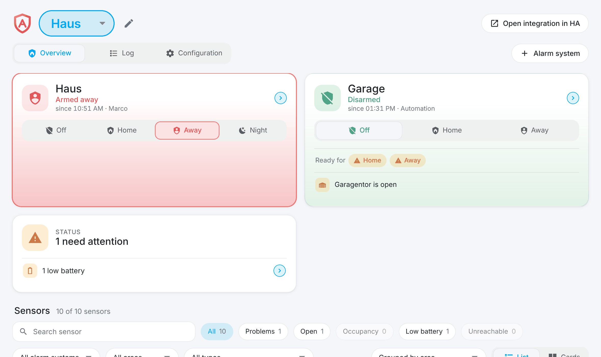</p>

## Why Alarmageddon

- **No automations needed.** Everything that makes an alarm system is built in: zones per mode, entry and exit delay, siren and alarm sound, schedule, a code per person, confirmation by two sensors. You wire up nothing yourself, neither automations nor helpers nor scripts.
- **Push notifications come by themselves.** Alarm, entry delay, armed and disarmed, arming not possible, sensor unreachable, battery low: you only choose who receives them. The alarm notification brings its buttons along ("Acknowledge", "Disarm", "Silence alarm sound"), critical if you like, so that it sounds even in silent mode. If an open window keeps the system from arming, the message offers "Try again" and "Arm anyway".
- **Everything is set up graphically.** One side panel for sensors, zones, delays, alarm actions, notifications, schedule, codes and backup, on the computer and on the phone. No YAML. What happens on an alarm is a flow you put together from steps, and you try each step on the real devices with one button.
- **Your sensors are watched, not just used.** Battery level with a forecast, unreachable sensors, signal, firmware and the last change of every sensor in one list, plus the history of the last 30 days for each sensor. If a sensor drops out while armed, you are told, or it counts as an alarm if you like.
- **You see what happened.** Every alarm is recorded with a timeline: which sensor responded when, which steps ran, which notifications went out, who acknowledged.
- **Built to alarm when in doubt.** Delays and alarms survive a restart, nothing can hold up the siren, and a watchdog supervises the alarm actions. See [Safety mechanisms](#safety-mechanisms).
- **Fits into Home Assistant.** Each alarm system is an ordinary `alarm_control_panel` entity for dashboards, your own automations and other systems such as Apple Home. Any sensor Home Assistant knows works: Zigbee, Z-Wave, Thread/Matter, Wi-Fi or Bluetooth.
- **Stays at home.** No cloud, no account: everything runs in your Home Assistant.

## Quick start

1. **Install:** HACS → three dots → "Custom repositories" → `https://github.com/Diegofuego871/ha-alarmageddon`, type "Integration". Install "Alarmageddon" and restart Home Assistant.
2. **Add an alarm system:** Settings → Devices & services → "Add integration" → "Alarmageddon". Give it a name and, if you like, a code. Once the panel is open, further alarm systems you add right there with "Add alarm system" (name and a preview of its entity ID; sensors, modes and code follow in the configuration). An alarm system you no longer need you delete at the bottom of Configuration › Alarm system (only while disarmed, after typing its name, with an optional backup first).
3. **Choose the sensors:** open "Alarmageddon" in the sidebar (administrators only), then Configuration › Sensors › "Add sensors", and tick the zones "Home", "Away" and "Night".
4. **Decide what happens on an alarm:** Configuration › Actions, for example "push notification, siren on, wait 3 minutes, siren off".
5. **Choose who is notified:** Configuration › Notifications. "Send test message" and the play button of a step let you try everything without an alarm.

## A tour

### Overview

All alarm systems at a glance: arm and disarm, "Ready for" per mode with the sensors that still block arming, a status tile for warnings, and all sensors as a list or as cards (all the same height), with search, filters, sorting, a choice of columns and grouping by area, sensor type or alarm system. A tap on a sensor opens its view: what it did over the last hours or up to 30 days (with a chart for each kind of sensor and the list of events), how its battery and its signal are doing, and a button that opens it in Home Assistant. In the view you also choose how the sensors are called: "Device - Sensor" or only the name of the sensor, the same everywhere down to the push notification. The same on the phone:

<p align="center">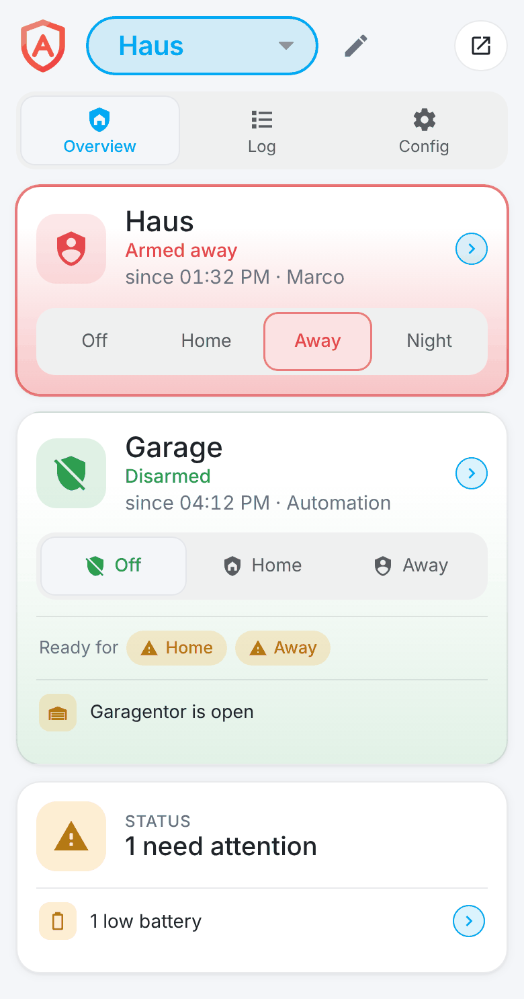</p>

### Sensor view

A tap on a sensor shows what it did: a chart of its own for each kind of sensor over 3 hours up to 30 days (doors and windows as a timeline, motion as a grid of day and hour), below it the events with their duration and the state of the alarm system at that moment. The tiles "Battery" and "Signal" show their history, the battery with the warning threshold, battery replacements and a forecast.

<p align="center">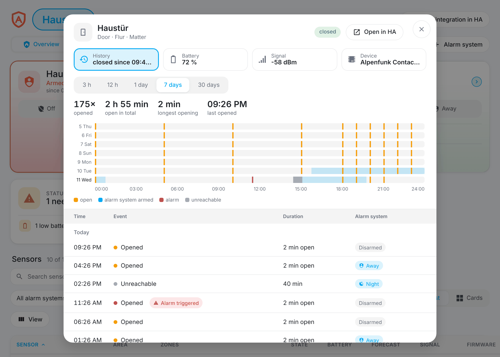</p>

### Sensors and zones

One table for sensors and zones: tick where a sensor belongs, or drag across several boxes. Every sensor type has sensible defaults (a smoke detector is always active, a motion sensor may still report motion when arming), each sensor can have its own values, and the switch "Settings per mode" adds a tab per mode for those who want more.

<p align="center">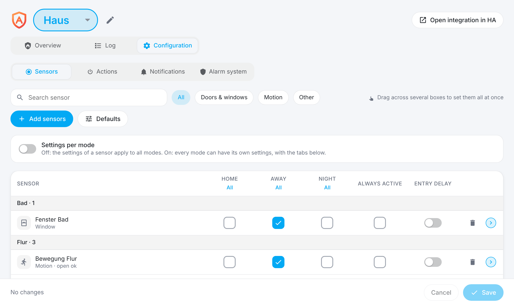</p>

### Alarm actions

What happens on an alarm is a flow you build from steps, per mode if you like. Devices marked with the arrow return to their previous state when you disarm, and every step can be tested on the real devices with its play button.

<p align="center">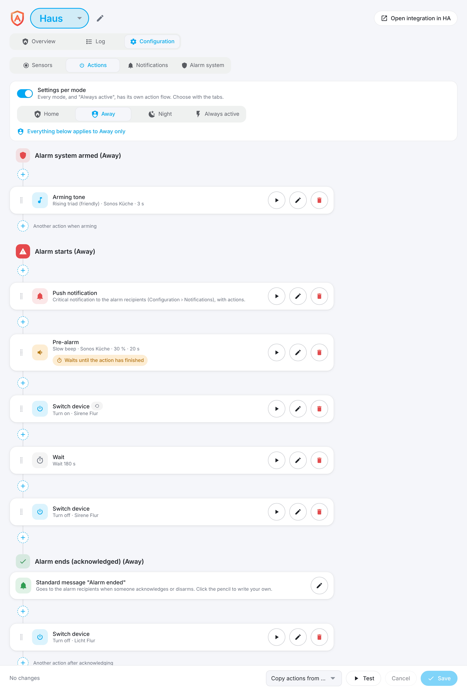</p>

<p align="center">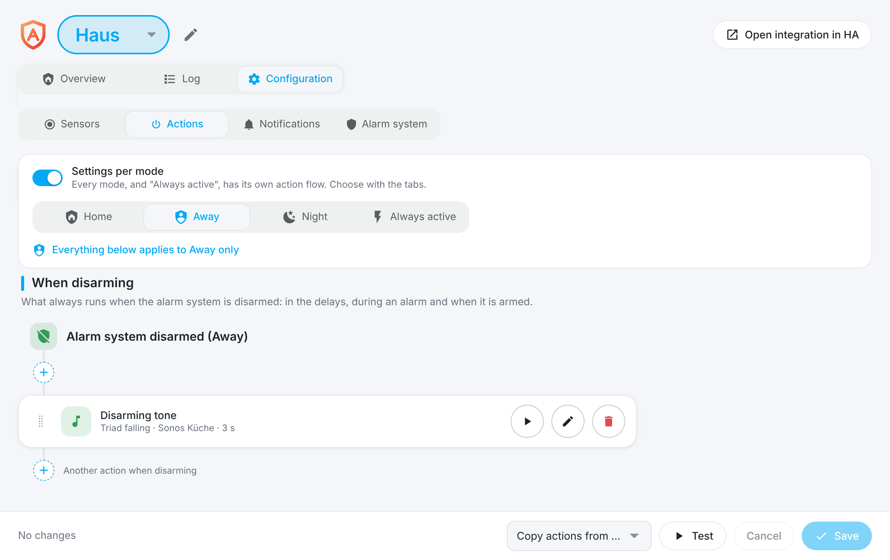</p>

| Step | Does |
| --- | --- |
| Push notification | Critical alarm notification to the alarm recipients, with your own title and text (placeholders for alarm system, sensor, sensor type, area, time, mode and kind of alarm; smoke, water, gas and heat sensors bring a fitting default text), optional buttons and, if you like, its own recipients (every title starts with an emoji) |
| Switch device | Lights, sockets, sirens, covers, locks and more: on, off, open, close, with brightness or position |
| Play alarm sound | One of five sounds on media players, with volume, for a duration or until disarmed |
| Wait | Pauses the following steps, for example between "siren on" and "siren off" |
| End alarm (acknowledge) | Ends the alarm after the steps before it (for example after 3 minutes), returns the devices and keeps the alarm system armed; the steps after it do not run |
| Scene, script or own action | Anything else Home Assistant can do |

### Notifications

Recipients are chosen separately for alarms and for maintenance messages, and every message can override them with its own recipients (per mode too). Every kind of message (entry delay, armed, disarmed, arming not possible, silent alarm, sensor unreachable, low battery) can be switched on or off, be critical (sounds in silent mode) and have its own volume, per mode if you like. "Arming not possible" carries two buttons: "Try again" arms the same mode once more, "Arm anyway" arms although sensors are open and bypasses them until you disarm. They work for one hour, only while the system is disarmed and only from the phone of a recipient of that message; each can be switched off.

### When there is an alarm

An alarm cannot be overlooked: a red band with the sensor that triggered and the buttons "Acknowledge" (the alarm ends, the system stays armed) and "Disarm". The tile of the alarm system says since when the alarm has been running, what triggered it and who armed the system when. The same buttons are in the push notification on the lock screen.

<p align="center">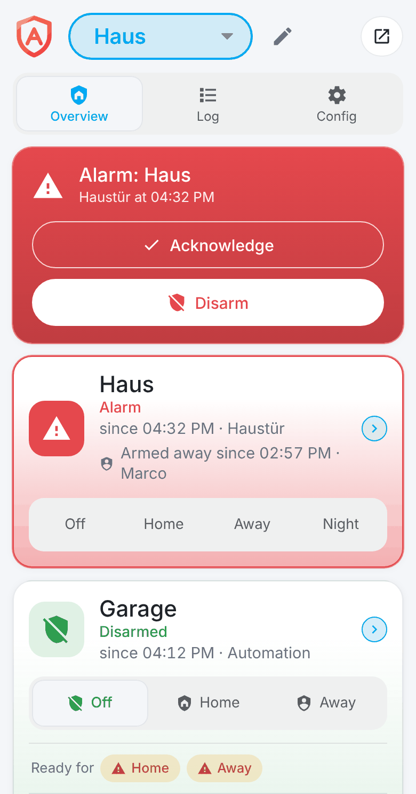</p>

### Log and alarm timeline

Every alarm is recorded from the first trigger until someone acknowledges it: which sensor responded when, which steps ran, which notifications went out. All other events (armed, disarmed, schedule, sensor failures) are on the second tab, with a filter by period and a CSV export. Both are kept for a year; you can delete a single alarm.

An alarm as it happens, with invented data (phone on the left, computer on the right):

<p align="center">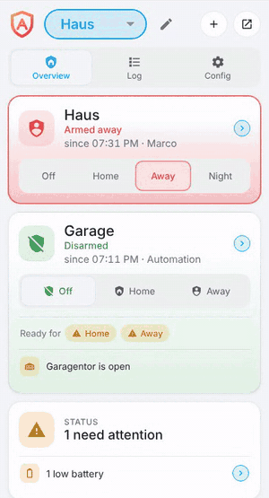 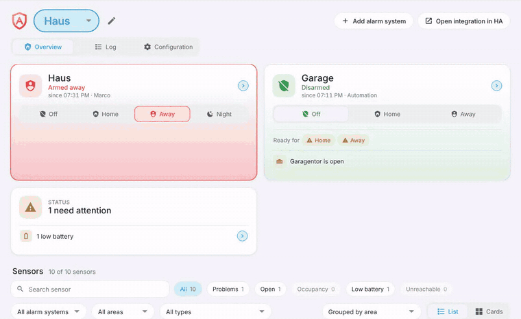</p>

<p align="center">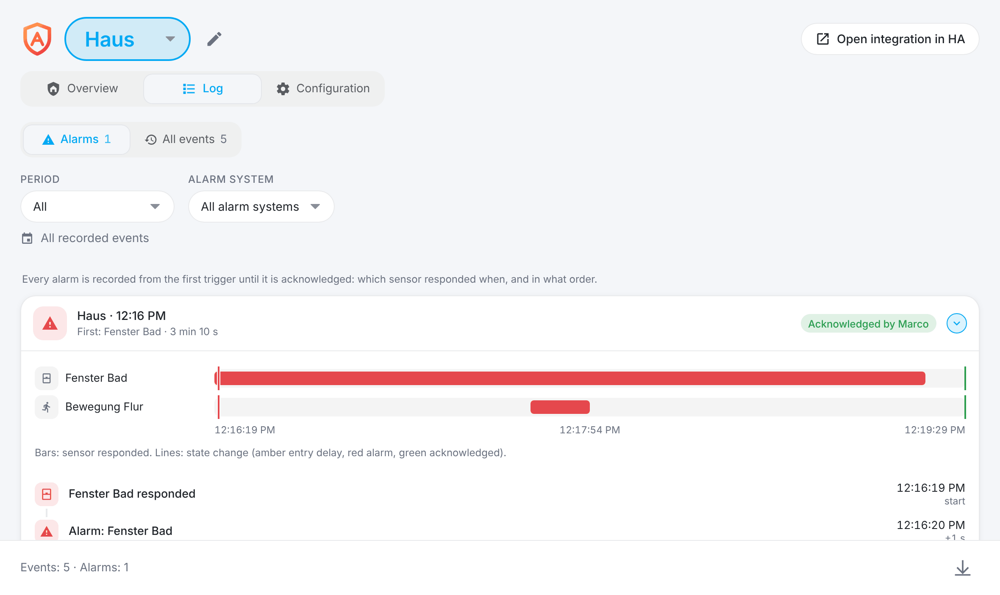</p>

### Dashboard cards

The control tile and the status tile of the side panel are also available as cards for any dashboard: "Add card" › "Alarmageddon". Anyone who may see the dashboard can use the card, not only administrators. A code is asked for wherever one is programmed; whether "Acknowledge" needs it, the administrator decides in Configuration › Alarm system.

<p align="center">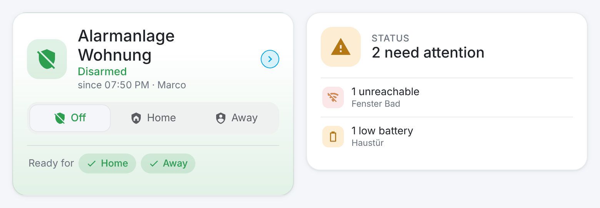</p>

If the card does not appear in the card picker: restart Home Assistant after the update, reload the page (Ctrl+Shift+R; in the app: Settings › Troubleshooting › reset the frontend cache), or add a card manually with `type: custom:alarmageddon-card` and `entity: alarm_control_panel.<name>`. The message "Custom element doesn't exist" means the card file was not loaded yet.

### More

- **Schedule:** arm or disarm at set times on chosen weekdays. A running alarm is never disarmed by the schedule.
- **Codes per person:** everyone gets their own code; the log shows who armed and disarmed.
- **Modes:** "Home", "Away" and "Night", each switchable on and off, each with its own zone, delays and actions.
- **Two-sensor confirmation:** a motion sensor can require a second sensor before it triggers, against false alarms.
- **Backup:** all settings as a file or stored in the integration, never with codes.
- **Several alarm systems:** house and garage, each as its own device.

## Safety mechanisms

An alarm system has to work when something else does not. These mechanisms are built in and checked by tests on every change.

<p align="center">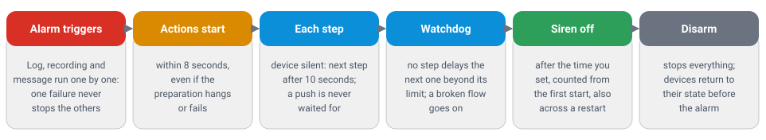</p>

| Mechanism | What it guarantees |
| --- | --- |
| When in doubt, alarm | An entry delay that ran out while Home Assistant restarted becomes an alarm. During an entry delay or an alarm, arming is refused: only disarming leads out |
| Safe on restart | State, delays and a running alarm continue after a restart; the alarm actions go on at the step they had reached |
| Codes | 4 to 8 digits, stored only as a salted hash, never shown, never in a backup or a log. Five wrong codes lock the alarm system for one minute, also for the right code |
| Administrators only | The side panel and every one of its commands need administrator rights. The dashboard cards use only entities and services, with the codes Home Assistant checks |
| Buttons in the alarm notification | "Disarm" and "Silence alarm sound" are off by default, "Acknowledge" is on. They only work while the alarm is running and only from the phone of a configured alarm recipient |
| Nothing holds up the siren | A device that does not answer is skipped after 10 seconds, a push notification is never waited for, and a failing step, log, recording or notification never stops the rest |
| Watchdog | The alarm actions are supervised as a whole: the first step starts within 8 seconds, no step delays the next one beyond its limit, and a flow that breaks off goes on with the next step. Interventions appear in the timeline of the alarm |
| You decide how long the siren sounds | There is no fixed duration in the code. You set it in the flow ("wait" between on and off, or a duration for a sound, up to an hour per step). It is kept exactly and counts from the first start, also across a restart |
| Sensors that fail | A sensor that becomes unreachable while armed is reported at once, or triggers the alarm with the option "failure counts as alarm". Low batteries are reported before they are empty |
| Tested | More than 900 automated tests against a real Home Assistant, about 4,000 checks of the interface on computer and phone, and a mutation check that removes each of 155 safeguards and requires a test to fail |

### Limits

Alarmageddon is not a certified alarm system. Please keep in mind:

- If Home Assistant, the power, the network or the radio coordinator fails, there is no alarm. A siren with its own battery helps for critical use.
- How long a siren may sound is regulated differently from place to place. Check what applies to you and set the duration in the alarm actions; a siren with its own time limit is the safest choice.
- A sound "until disarmed" and a siren without an "off" step run until someone disarms. That is your choice in the flow.

## Apple HomeKit

1. Add the alarm entity to the HomeKit Bridge of Home Assistant (include the domain `alarm_control_panel` or the entity).
2. Apple Home shows "Off" and the modes that are switched on.
3. With a code: HomeKit does not ask for it. Set it in the HomeKit Bridge configuration (`entity_config` → `code`) or as default code in the entity settings.

## Entities

| Entity | Content |
| --- | --- |
| `alarm_control_panel.<name>` | The alarm system. Attributes: `arm_mode`, `triggered_by`, `bypassed_sensors`, `deadline`, `changed_by`, `armed_at`, `armed_by`, `state_since` (since when it is in its state; survives a restart) |
| `binary_sensor.<name>_zone_<mode>` | On when a sensor of the zone of this mode is open |
| "Ready to arm" per mode | On when no open sensor blocks arming in this mode. Attribute: `blocking_sensors` |
| `sensor.<name>_status` | Number of open problems: alarm, unreachable sensors, weak batteries. Attributes: `alarm`, `offline`, `low_battery`, `battery_threshold` |

Zone and "Ready" entities exist only for the modes that are switched on.

Service `alarmageddon.acknowledge` (target: the alarm entity, optional `code`): silences a running alarm; usable by every user, used by the dashboard card.

## Good to know

Details for those who want to know exactly. Click to open.

<details>
<summary><b>How an alarm runs</b></summary>

<p align="center">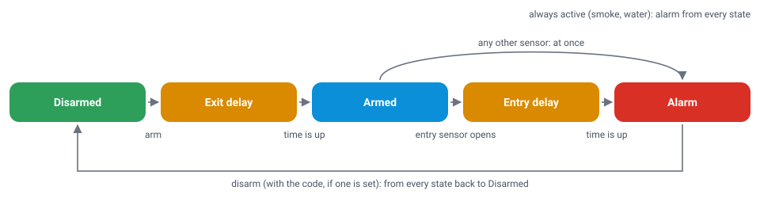</p>

- Only a real change from closed to open triggers. A sensor that comes back from "unavailable" as open does not.
- A sensor with entry delay (for example the front door) starts the entry delay; every other sensor triggers at once. An entry sensor can have its own delay (sensor options), otherwise the delay of the system applies. A second entry sensor does not extend the delay.
- Sensors set to "always active" (smoke, water, gas) trigger in every state, also when disarmed.
- The alarm lasts until someone disarms. How long siren, light and sound run is set in the alarm actions.
- Open sensors block arming, unless they may be open or are bypassed until the next disarming.

</details>

<details>
<summary><b>Numbers and limits</b></summary>

| What | Value |
| --- | --- |
| Exit delay | Default 60 s for "Away", none for "Home" and "Night"; up to 3600 s per mode |
| Entry delay | Default 30 s, per mode and per sensor if you like |
| Confirmation window for the second sensor | Default 60 s |
| Wrong codes | Five, then locked for 60 s |
| Code storage | PBKDF2-SHA256 with 120,000 rounds and a salt per code |
| Device does not answer | Next step after 10 s |
| First step after the alarm triggers | 8 s at most (watchdog) |
| Wait and sound duration | 0 to 3600 s per step, up to 40 steps per flow |
| Test of the alarm actions | Ends after 60 s at the latest |
| Low battery, sensor unreachable | Below 20 %, after 60 minutes (both adjustable) |
| Kept per alarm system | Events and alarms for one year (at most 5000 events and 200 alarms with 300 entries each); 10 backups in total |

</details>

<details>
<summary><b>Options per sensor</b></summary>

- **Always active:** can be switched off as a whole (Configuration › System). Triggers in every state, armed or disarmed, at once (smoke, water, gas), with the options of the tab "Always active". If the sensor is also in the zone of a mode, only that mode counts while the alarm system is armed in it (its settings and its actions); with the switch "Armed in <mode>: only <mode> counts" off, "Always active" applies as well: the sensor triggers at once and both flows of alarm actions run. When disarmed, and in modes that do not contain the sensor, the actions of "Always active" run.
- **May be open when arming:** an open sensor does not block arming and triggers after it was closed and opened again.
- **Bypass when arming:** an open sensor is ignored until the next disarming.
- **Arm as soon as closed:** closing this sensor during the exit delay (the front door behind you) arms at once instead of waiting for the delay to end.
- **Failure counts as alarm:** an unreachable sensor triggers the alarm while armed.
- **Needs a second sensor:** triggers only if another sensor with this option responds within the confirmation window.
- **Silent alarm:** sends a message instead of triggering the alarm, at most once per minute.

</details>

<details>
<summary><b>Alarm actions and notifications in detail</b></summary>

- **Steps keep running:** by default the next step starts right away, so the actions run through one after the other as fast as possible. With "Wait until the action has finished" the next one starts only when this one is done; the step then carries a pill. A sound "until disarmed" cannot be waited for. Flows from earlier versions behave as before.
- **Four kinds of tones, each with its own sounds:** the **alarm sound** (the sound of the alarm, five sounds from siren to yelp; the push button "Silence alarm sound" stops it), the **pre-alarm** (a quiet warning tone before the alarm sound, five sounds such as chime, warning or a slow beep; the next step follows after it) the **arming tone** (short, subtle or friendly, seven sounds from beep to a rising triad) and the **disarming tone** (its counterpart, five falling sounds such as a descending triad or a deep bell). You can preview each one in the panel. A tone plays in one piece for its whole duration: the speaker is started once, and the tone begins and ends softly. You set the volume for all media players together or for each one separately, for example quieter in the bedroom.
- **When arming:** below "Alarm system armed" there are actions that run as soon as the system is armed, per mode: for example an arming tone (a short beep, you set how long it sounds), plus device, wait, scene and custom action. Disarming stops a running tone at once, an alarm has priority.
- **During the delays:** "Arming begins" (while the exit delay runs) and "Entry delay running" (while the time to disarm runs) are fixed points of their own, per mode. Arming tone or pre-alarm there can last exactly as long as the delay that is running (a switch in the step), so it tells everyone to leave or to disarm. The alarm never waits for these actions. The points only show where the delay exists (above 0). Drag a step by its handle onto another list (also an empty one) to move it there; lists only take the steps that make sense in them; near the edge the page scrolls along.
- **Tones put the speaker back.** Arming tone, disarming tone, pre-alarm and the alarm sound in the lists outside the alarm flow remember how the speaker was (on or off, volume, playback), play at the chosen volume and put it back afterwards. On by default, switchable per step.
- **When disarming:** at the very bottom of the actions page the chapter "When disarming" has a list of its own under the fixed point "Alarm system disarmed", per mode (the mode that was armed). Whatever you put there always runs when the alarm system is disarmed, also in the middle of a delay or an alarm (after the actions after acknowledging): for example a disarming tone, a device, a wait, a scene or your own action. Arming again or an alarm ends it at once.
- **After acknowledging:** behind "Alarm ends (acknowledged)" there are actions of their own that run as soon as the alarm is acknowledged or the system is disarmed, for example close the blinds or switch off a light. Possible are device, sound with a duration, wait, scene and custom action. A new alarm cancels them.
- **Back to the previous state:** on or off, brightness, position, volume and source; media players that can save their whole playback (source, title, group) use that.
- **Test:** runs the saved flow without an alarm and stops after 60 seconds at the latest. A real alarm during a test starts the real flow at once.
- **Media players** fetch the sounds from Home Assistant, so they must reach its local URL (Settings → System → Network).
- **Buttons of the alarm notification:** "Open" (on by default), "Silence alarm sound" (stops the steps, the alarm stays), "Acknowledge" (on by default; ends the alarm, the alarm system stays armed and alarms again at the next trigger) and "Disarm" (iOS asks for Face ID or the passcode, Android does not).
- **Critical notifications:** the volume applies to iOS; Android plays them on the alarm channel, set its volume on the phone.
- **Maintenance messages:** each problem once, several in one notification, again after the battery was replaced or the sensor responded.
- **Battery forecast:** from the recorder history of the last 90 days; empty without enough history.

</details>

<details>
<summary><b>Schedule, backup and HomeKit in detail</b></summary>

- **Schedule:** open sensors block arming as usual; no code is needed; times missed while Home Assistant was off are not made up. Disarming by schedule means the alarm system is off at that time, whoever is at home.
- **Backup:** up to 10 backups in the integration, plus export and import as a file. When restoring you choose for each alarm system of the backup what it is applied to: an existing alarm system (whatever its name), a new one, or none; the shared settings can be left out. Codes are never included; the backup of Home Assistant itself contains everything.
- **HomeKit, exit delay:** Apple Home shows "Off" with the target "Away" during the exit delay. Use no exit delay for "Home" and "Night" (default).
- **HomeKit, entry delay:** Apple Home keeps showing "armed" and switches to "Alarm" when the alarm starts.

</details>

<details>
<summary><b>For developers</b></summary>

```bash
pip install -r requirements_test.txt
python -m pytest                      # tests against a real Home Assistant
python scripts/mutation_check.py      # removes each safeguard, a test must fail
cd tests/panel && npm ci && node run.mjs   # interface tests (Playwright)
```

- The images of this page come from the simulator: `node tests/panel/readme-shots.mjs`, then `python scripts/optimize_images.py`; the diagrams from `python scripts/make_diagrams.py`.
- Concept and decisions: [docs/CONCEPT.md](https://github.com/Diegofuego871/ha-alarmageddon/blob/main/docs/CONCEPT.md) (German). Changes: [CHANGELOG.md](https://github.com/Diegofuego871/ha-alarmageddon/blob/main/CHANGELOG.md).

</details>

## Languages

The integration is in English and switches to German when Home Assistant runs in German.

## License

See [LICENSE](https://github.com/Diegofuego871/ha-alarmageddon/blob/main/LICENSE).
